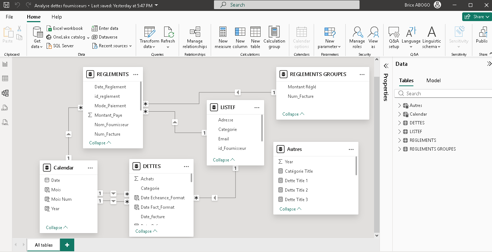
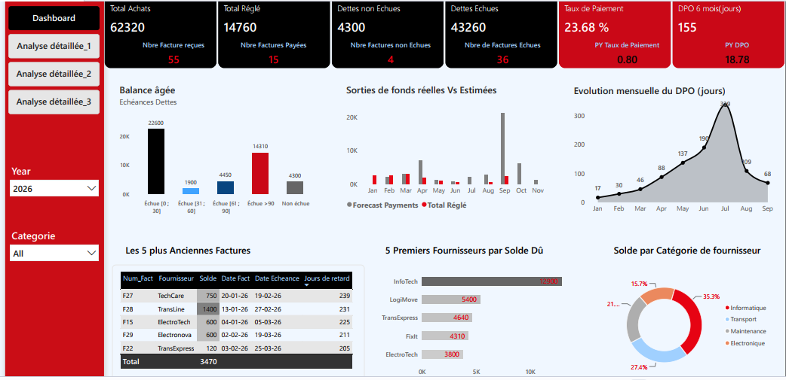
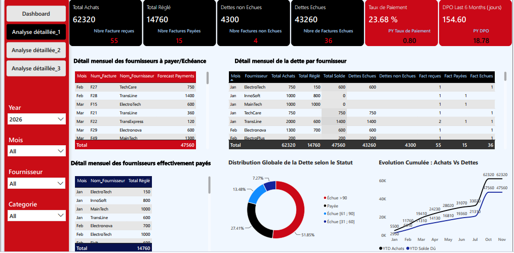
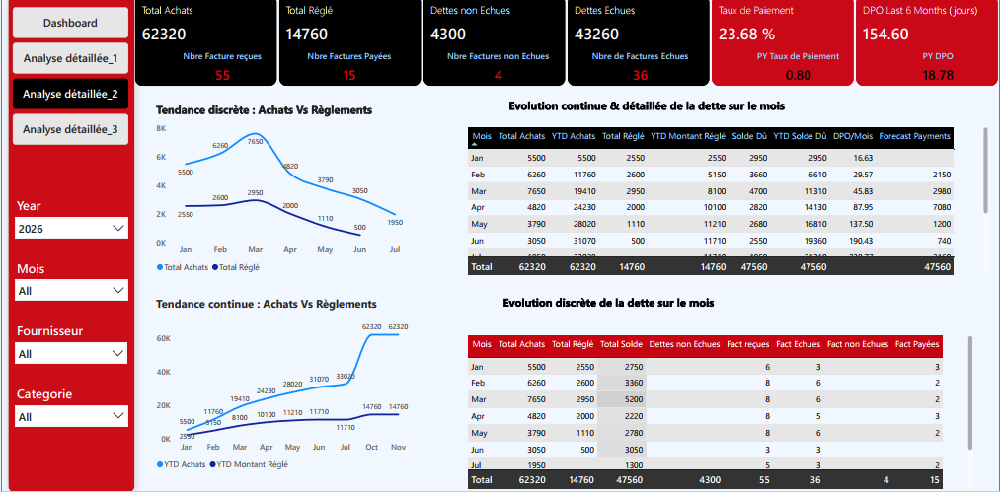
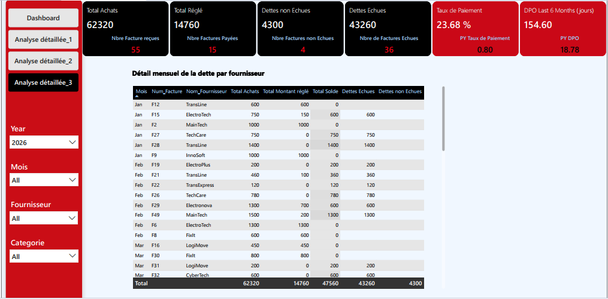

# Accounts Payable Analytics
## Supplier Debt Management, Payment Performance & Cash Flow Forecasting

### An End-to-End Financial Business Intelligence Project

**Author:** Brice Abogo  
**Specialization:** Financial Analysis | Accounting | Business Intelligence  
**Technologies:** SQL Server | Power Query | DAX | Power BI | Power BI Service

---

## 1. Project Overview

This project presents an end-to-end Business Intelligence solution designed to strengthen accounts payable management, supplier payment monitoring, and short-term cash flow forecasting.

The solution integrates supplier invoices, payment transactions, and supplier master data into an interactive Power BI reporting environment.

By combining financial accounting expertise with SQL-based data analysis, Power Query transformations, relational data modeling, and DAX calculations, the project transforms accounting transactions into actionable financial insights.

The solution enables financial managers to:

- Monitor purchases, payments, and outstanding liabilities.
- Identify overdue invoices and analyze their aging structure.
- Assess supplier payment performance.
- Monitor key financial indicators, including payment rates and estimated Days Payable Outstanding (DPO).
- Identify suppliers representing significant financial exposure.
- Analyze monthly and cumulative financial trends.
- Forecast future cash outflows using contractual payment due dates.
- Strengthen accounting reconciliation and internal controls.

The project also demonstrates the integration of locally hosted data sources with Power BI Service through an On-premises Data Gateway.

---

## 2. Business Problem

Efficient accounts payable management is essential for maintaining adequate liquidity, preserving supplier relationships, and optimizing working capital.

However, organizations frequently face challenges such as:

- Limited visibility over unpaid supplier invoices.
- Difficulties identifying overdue liabilities.
- Insufficient monitoring of payment deadlines.
- Inadequate short-term cash flow forecasting.
- Fragmented supplier and payment information.
- Limited analytical support for financial decision-making.

These challenges may contribute to liquidity pressures, delayed payments, supplier disputes, and inefficient allocation of financial resources.

### Central Business Question

**How can financial data analytics improve supplier debt monitoring, payment performance evaluation, and cash flow forecasting to strengthen working capital management?**

---

## 3. Project Objectives

The main objective is to develop an interactive financial analytics solution that provides management with reliable information on supplier liabilities and payment performance.

Specific objectives include:

1. Consolidating supplier invoices, payment transactions, and supplier master data.
2. Monitoring total purchases, payments, and outstanding liabilities.
3. Classifying unpaid invoices according to their aging status.
4. Measuring payment performance through financial KPIs.
5. Identifying suppliers with the highest outstanding balances.
6. Analyzing monthly and cumulative purchasing and payment trends.
7. Forecasting supplier payments based on contractual due dates.
8. Strengthening accounting reconciliation and internal controls.
9. Supporting working capital optimization and financial planning.

---

## 4. Tools & Technologies

| Technology | Application |
|---|---|
| Microsoft SQL Server | Data storage, SQL querying and financial data validation |
| Power Query (M) | Data extraction, cleaning, transformation and reconciliation |
| Power BI Desktop | Relational data modeling and interactive dashboard development |
| DAX | Financial KPIs, dynamic calculations and time intelligence |
| Power BI Service | Report publication and semantic model management |
| On-premises Data Gateway | Secure connectivity to locally hosted data sources |
| GitHub | Technical documentation and project portfolio |

---

## 5. Dataset Description

The project integrates three main financial datasets and a calendar dimension.

### DETTES — Supplier Invoices

Contains invoice-level information, including:

- Invoice number and supplier identification.
- Invoice date and purchase amount.
- Contractual payment terms.
- Payment due date.
- Outstanding balance.
- Payment status and overdue days.

### REGLEMENTS — Supplier Payments

Contains payment transaction information:

- Payment identification.
- Supplier and invoice references.
- Payment date.
- Payment amount.
- Payment method.

### LISTEF — Supplier Master Data

Contains supplier information:

- Supplier identification.
- Supplier name.
- Supplier category.
- Contact information.

### Calendar — Date Dimension

Supports financial time intelligence through:

- Date.
- Year.
- Month.
- Month number.

An additional aggregated payments query supports invoice-level reconciliation.

---

## 6. Data Preparation & Transformation

Power Query was used to prepare, transform, and reconcile supplier accounting data.

The transformation process includes:

- Data type verification and conversion.
- Date standardization.
- Supplier and invoice identifier validation.
- Calculation of contractual payment due dates.
- Calculation of overdue days.
- Aggregation of multiple payments per invoice.
- Reconciliation between invoices and payments.
- Calculation of outstanding invoice balances.
- Identification of data quality exceptions.

### Accounting Reconciliation

A fundamental accounting control consists of verifying:

**Outstanding Payables = Total Purchases − Total Payments**

For this dataset:

**62,320 − 14,760 = 47,560**

A complementary reconciliation confirms:

**Overdue Payables + Not-Yet-Due Payables = Outstanding Payables**

**43,260 + 4,300 = 47,560**

These reconciliations support the consistency of the financial information presented.

Detailed Power Query scripts and transformation documentation are available in the project's technical directories.

---

## 7. Data Modeling

The Power BI solution uses a relational data model connecting:

- Supplier invoices.
- Supplier payment transactions.
- Supplier master data.
- A calendar dimension.

The model supports financial analysis by supplier, invoice, category, and reporting period.

Active and inactive relationships are used where appropriate to manage different transaction dates, including invoice dates, payment dates, and contractual due dates.

### Data Model



---

## 8. Key Financial Performance Indicators

The dashboard provides the following financial results:

| Financial KPI | Result |
|---|---:|
| Total Purchases | 62,320 |
| Total Payments | 14,760 |
| Outstanding Payables | 47,560 |
| Overdue Payables | 43,260 |
| Not-Yet-Due Payables | 4,300 |
| Payment Rate | 23.68% |
| Supplier Invoices | 55 |
| Fully Paid Invoices | 15 |
| Overdue Invoices | 36 |
| Not-Yet-Due Invoices | 4 |
| Estimated DPO — Last Six Months | 154.60 days |

**Note:** Financial amounts are expressed in the reporting currency of the dataset.

---

## 9. Estimated Days Payable Outstanding (DPO)

The project uses a customized estimated DPO indicator calculated over a dynamic six-month reporting period.

### Calculation Methodology

**Estimated DPO = (Net Outstanding Payables / Total Purchases) × Number of Days in the Period**

Where:

**Net Outstanding Payables = Total Purchases − Total Payments**

The reference date is determined automatically using the latest supplier payment recorded in the dataset.

The calculation then identifies the six-month reporting period ending on the last day of the reference month.

For example, if the latest payment occurred in September 2026, the calculation covers:

**April 1, 2026 – September 30, 2026**

### Current Result

**Estimated Six-Month DPO: 154.60 days**

### Methodological Note

This is a customized estimated payment-period indicator based on purchases and payments recorded during the selected period.

It differs from conventional accounting DPO, which typically uses average accounts payable divided by credit purchases.

Consequently, the result should not be interpreted as the actual average number of days between invoice issuance and settlement.

The complete DAX implementation is documented in the project's DAX directory.

---

## 10. Dashboard Overview

The Power BI report contains four interactive analytical pages.

### Dashboard 1 — Executive Financial Overview

Provides a consolidated view of:

- Total purchases and payments.
- Outstanding and overdue liabilities.
- Payment rate and estimated DPO.
- Accounts payable aging.
- Actual versus forecast payments.
- Five oldest outstanding invoices.
- Top five suppliers by outstanding balance.
- Outstanding liabilities by supplier category.



### Dashboard 2 — Supplier Debt & Payment Analysis

Provides:

- Monthly supplier payment forecasts.
- Actual payments by supplier.
- Supplier debt by invoice status.
- Cumulative purchases versus outstanding liabilities.
- Detailed supplier payment information.



### Dashboard 3 — Monthly Financial Performance

Provides:

- Monthly purchasing and payment trends.
- Year-to-date purchases.
- Year-to-date payments.
- Outstanding liabilities evolution.
- Monthly DPO indicators.
- Invoice status analysis.
- Forecast cash requirements.



### Dashboard 4 — Detailed Accounts Payable Register

Provides detailed invoice-level information:

- Invoice number.
- Supplier name.
- Purchase amount.
- Payments made.
- Outstanding balance.
- Overdue liabilities.
- Not-yet-due liabilities.



---

## 11. Key Financial Findings

### Finding 1 — Significant Outstanding Liabilities

Outstanding payables amount to **47,560**, representing approximately **76.32% of total purchases**.

This indicates that a substantial proportion of supplier obligations remains unpaid.

### Finding 2 — High Overdue Exposure

Overdue liabilities total **43,260**, representing approximately **90.96% of total outstanding payables**.

This suggests significant exposure to supplier payment delays.

### Finding 3 — Limited Payment Coverage

The overall payment rate stands at **23.68%**.

Recorded payments therefore cover less than one-quarter of total purchases.

### Finding 4 — Supplier Concentration Risk

The five suppliers with the highest outstanding balances are:

| Supplier | Outstanding Balance |
|---|---:|
| InfoTech | 12,900 |
| LogiMove | 5,400 |
| TransExpress | 4,640 |
| FixIt | 4,310 |
| ElectroTech | 3,800 |

Their combined outstanding balance is **31,050**, representing approximately **65.29% of total outstanding payables**.

This indicates a concentration of supplier credit exposure among a limited number of suppliers.

### Finding 5 — Estimated Payment Period

The estimated six-month DPO stands at **154.60 days**.

Combined with the high proportion of overdue liabilities, this highlights the importance of strengthening payment scheduling and working capital monitoring.

---

## 12. Business Recommendations

### Recommendation 1 — Prioritize Overdue Payments

Implement a structured supplier payment schedule based on invoice aging, outstanding balances, supplier criticality, and contractual payment terms.

### Recommendation 2 — Strengthen Cash Flow Forecasting

Develop rolling three-month cash flow forecasts using outstanding invoice balances and contractual due dates.

### Recommendation 3 — Improve Supplier Reconciliation

Perform regular reconciliation between supplier invoices, payment transactions, and outstanding balances.

### Recommendation 4 — Monitor Major Supplier Exposures

Establish enhanced monitoring procedures for suppliers representing the highest outstanding liabilities.

### Recommendation 5 — Define Payment Performance Targets

Introduce measurable management targets for payment rates, overdue balances, outstanding liabilities, and estimated DPO.

Review these indicators regularly to support corrective financial decisions.

---

## 13. Technical Architecture

The solution follows an end-to-end financial analytics workflow:

```text
Local Financial Data Sources
            |
            v
      Microsoft Excel
            |
            v
      Power Query (ETL)
            |
            v
   Financial Data Validation
            |
            v
    Relational Data Modeling
            |
            v
      DAX Financial KPIs
            |
            v
      Power BI Dashboards
            |
            v
       Power BI Service
            |
            v
   On-Premises Data Gateway
            |
            v
     Scheduled Data Refresh
```

The project demonstrates practical experience in data preparation, financial reconciliation, relational modeling, dashboard development, and cloud reporting infrastructure.

---

## 14. Skills Demonstrated

### Financial & Accounting

- Accounts Payable Management.
- Supplier Account Reconciliation.
- Working Capital Analysis.
- Cash Flow Forecasting.
- Invoice Aging Analysis.
- Financial Reporting.
- Payment Performance Monitoring.
- Internal Control.
- Supplier Risk Assessment.

### Data Analytics & Business Intelligence

- Microsoft SQL Server.
- Power Query (M).
- Power BI Desktop.
- DAX.
- Relational Data Modeling.
- Data Cleaning and Transformation.
- Financial KPI Development.
- Time Intelligence.
- Interactive Dashboard Design.

### Data Infrastructure

- Power BI Service.
- On-premises Data Gateway.
- Semantic Model Configuration.
- Data Source Connectivity.
- Scheduled Refresh Configuration.
- Refresh Monitoring.

---

## 15. Project Repository Structure

The repository is organized as follows:

```text
accounts-payable-analytics/
│
├── README.md
├── images/
├── data/
├── powerquery/
├── dax/
├── sql/
├── documentation/
└── reports/
```

Each directory contains the relevant scripts, visualizations, reports, or technical documentation.

---

## 16. Power BI Dashboard & Report

The Accounts Payable Analytics dashboard was developed
using Power BI Desktop and published to Power BI Service.

The complete report is available in PDF format,
allowing recruiters and other visitors to review
the financial analysis without requiring a Power BI account.

### Explore the Project

[**View the Complete Power BI Dashboard (PDF)**](reports/accounts-payable-dashboard.pdf)

[**Explore Dashboard Screenshots**](images/)

[**View the Power BI Data Model**](images/data-model.png)

Public interactive access is currently unavailable
due to Power BI sharing restrictions.
---

## 17. About the Author

### Brice Abogo

**Financial Analyst | Accountant | Data Analyst**

Finance and accounting professional with more than fifteen years of experience in accounting, auditing, financial management, and financial reporting.

Combining financial expertise with modern analytical tools, including SQL Server, Power BI, DAX, Excel, and Python, to transform financial data into actionable business insights.

**LinkedIn:** https://www.linkedin.com/in/brice-abogo

**Email:** briceabogo@gmail.com
**Email:** briceabogo@lynis.online

---

## 18. Project Status

**Status:** Portfolio Documentation in Progress

The project includes:

- Financial data transformation.
- Relational data modeling.
- DAX-based financial analysis.
- SQL-based financial analysis.
- Interactive Power BI dashboards.
- On-premises data gateway integration.
- Financial insights and business recommendations.

Technical scripts and supporting documentation are being progressively added to this repository.
